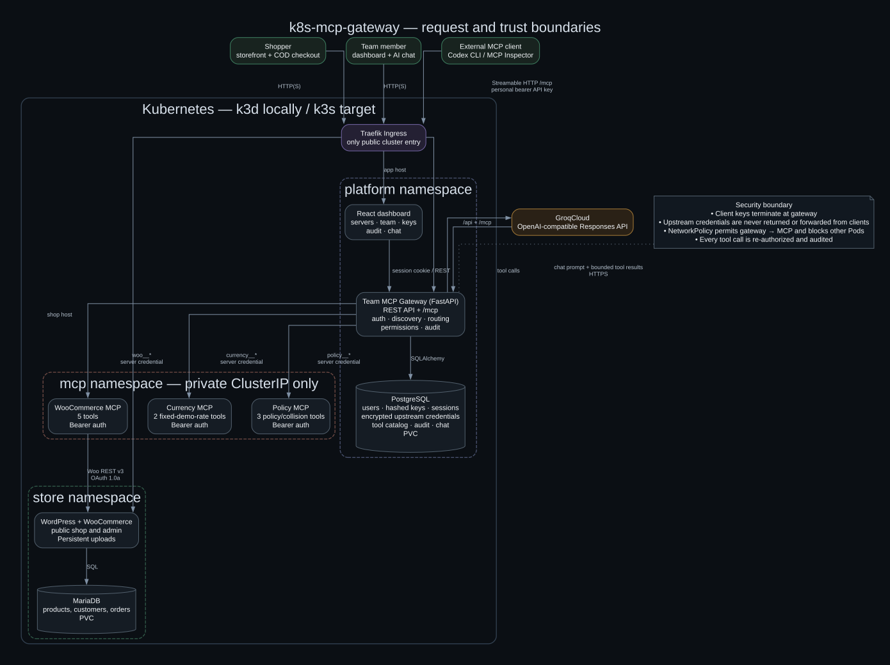

# k8s-mcp-gateway

**A Kubernetes-native WooCommerce store with one secure MCP endpoint for an entire team.**

An administrator connects MCP servers once. Team members then use every approved
tool through one personal API key—either from an external MCP client or from the
built-in AI chat. The gateway discovers and namespaces tools, keeps upstream
credentials private, applies authorization on every call, and records an audit
trail under the person who performed the action.

> **Implementation status:** the complete mandatory two-user flow has been
> exercised on local k3d, including a real WooCommerce product creation, COD
> order, three upstream MCP servers, key revocation, server disablement, outage
> isolation, and attributed audit records. The k3s values render from the same
> Helm templates; a live public VPS deployment and TLS certificate have not yet
> been completed.

## What it does

- Hosts a real WordPress + WooCommerce shop with MariaDB and persistent storage.
- Aggregates **three independent MCP servers** behind one authenticated
  Streamable HTTP endpoint: `POST /mcp`.
- Exposes ten tools as collision-safe aliases such as
  `woo__list_products` and `policy__list_products`.
- Lets admins manage upstream servers, invite members, issue or revoke keys, and
  inspect the complete audit trail.
- Lets members create their own API keys and use the tools without ever seeing
  an upstream credential.
- Runs dashboard AI chat through the gateway's own `/mcp` endpoint as the
  signed-in user, so chat and external clients share authorization and auditing.
- Isolates a failed upstream while the other MCP servers continue working.
- Uses the same umbrella Helm chart for local k3d and single-node k3s; only
  environment values, hosts, images, storage sizes, TLS, and Secrets differ.

## Architecture



The editable Graphviz source is
[`docs/images/system-architecture.dot`](docs/images/system-architecture.dot).

| Namespace | Workloads | Public access |
| --- | --- | --- |
| `store` | WordPress + WooCommerce, MariaDB, persistent volumes | Storefront and `/wp-admin` through Traefik |
| `mcp` | WooCommerce, currency, and policy MCP servers | None; private ClusterIP Services |
| `platform` | Gateway, dashboard, PostgreSQL, migrations/bootstrap Jobs | Dashboard, REST API, and `/mcp` through Traefik |

An external client's bearer key terminates at the gateway. It is never sent to
an upstream. The gateway selects a persisted alias, rechecks the user, key,
server, and permission, decrypts only that server's credential, makes one
bounded upstream call, and writes the outcome and duration to PostgreSQL.

## MCP servers and tools

| Server | Tools | Purpose |
| --- | --- | --- |
| `woo` | `list_products`, `create_product`, `list_orders`, `get_order`, `update_order_status` | Real WooCommerce REST operations; write calls are not silently retried |
| `currency` | `convert_currency`, `get_demo_rates` | Versioned fixed demonstration rates, explicitly not live FX |
| `policy` | `list_store_policies`, `get_store_policy`, `list_products` | Versioned demo policies plus a deliberate name-collision fixture |

The gateway publishes tools as `<server-slug>__<original-tool-name>`. The two
different `list_products` tools remain independently addressable as
`woo__list_products` and `policy__list_products`.

## A complete user journey

1. A shopper opens the public store, buys a product with Cash on Delivery, and
   WooCommerce persists the order in MariaDB.
2. User A signs into the dashboard as an admin and asks chat to create a product.
   The model requests `woo__create_product`; chat invokes the gateway `/mcp` as
   User A, and the product appears in WooCommerce.
3. User A invites User B. User B chooses a password and creates a personal MCP
   API key, which is displayed once and stored only as a hash.
4. User B configures one URL and one key in an MCP client. They can query the
   order through Woo and convert its INR total through Currency in one workflow.
5. The audit page identifies the user, server, tool, timestamp, duration,
   channel, and outcome for every call.
6. Revoking User B's key rejects the next MCP request. Disabling a server removes
   its tools and rejects cached aliases without redeploying the gateway.

## Technology stack

| Layer | Technology |
| --- | --- |
| Store | WordPress 7.1.3, WooCommerce 11.2.1, MariaDB 11.8.3 |
| MCP and gateway | Python, FastAPI, official MCP Python SDK 2.3.0, Pydantic |
| Platform state | PostgreSQL 17.6, SQLAlchemy, Alembic |
| Dashboard | React, TypeScript, Vite, TanStack Query |
| AI chat | GroqCloud OpenAI-compatible API, `openai/gpt-oss-20b` |
| Runtime | Docker, Kubernetes, Helm, Traefik, k3d locally, k3s target |

## Local deployment

### Prerequisites

- Docker Desktop with at least 4 CPUs and 6 GiB available
- `k3d`, `kubectl`, Helm 3, OpenSSL, and Git
- Python 3.11+ to run service tests outside containers
- A Groq API key only for AI chat; the rest works without chat
- Port `8080` available on the host

### 1. Create the cluster

```bash
k3d cluster create k8s-mcp-gateway \
  --image rancher/k3s:v1.35.5-k3s1 \
  --api-port 127.0.0.1:6550 \
  --port 127.0.0.1:8080:80@loadbalancer \
  --wait
kubectl config use-context k3d-k8s-mcp-gateway
kubectl apply -f infra/namespaces.yaml
```

### 2. Build and import the application images

```bash
docker build -f services/gateway/Dockerfile \
  -t k8s-mcp-gateway/gateway:0.1.0-local .
docker build -t k8s-mcp-gateway/woo-mcp:0.1.0-local services/woo-mcp
docker build -t k8s-mcp-gateway/aux-mcp:0.1.0-local services/aux-mcp
docker build -f web/dashboard/Dockerfile \
  -t k8s-mcp-gateway/dashboard:0.1.0-local .

k3d image import --cluster k8s-mcp-gateway \
  k8s-mcp-gateway/gateway:0.1.0-local \
  k8s-mcp-gateway/woo-mcp:0.1.0-local \
  k8s-mcp-gateway/aux-mcp:0.1.0-local \
  k8s-mcp-gateway/dashboard:0.1.0-local
```

### 3. Create Kubernetes Secrets

The chart references existing Secrets and never puts plaintext values in Helm
values or rendered manifests.

| Namespace | Secret | Required keys |
| --- | --- | --- |
| `store` | `store-mariadb` | `database`, `username`, `password`, `root-password` |
| `store` | `store-wordpress` | `database`, `username`, `password` |
| `store` | `store-wordpress-admin` | `username`, `password`, `email` |
| `mcp` | `woo-mcp` | `MCP_BEARER_TOKEN`, `WOOCOMMERCE_BASE_URL`, `WOOCOMMERCE_OAUTH_BASE_URL`, `WOOCOMMERCE_CONSUMER_KEY`, `WOOCOMMERCE_CONSUMER_SECRET` |
| `mcp` | `aux-mcp` | `CURRENCY_MCP_BEARER_TOKEN`, `POLICY_MCP_BEARER_TOKEN` |
| `platform` | `platform-postgres` | `database`, `username`, `password`, `database-url` |
| `platform` | `gateway` | `api-key-pepper`, `upstream-credential-key`, `internal-jwt-secret`, `groq-api-key` |
| `platform` | `gateway-bootstrap-admin` | `email`, `password` |
| `platform` | `gateway-upstreams` | `woo-credential` |

Keep values in local `.env.*` files, which are ignored by Git, and apply one
file per Secret:

```bash
chmod 600 .env.*
kubectl -n store create secret generic store-mariadb --from-env-file=.env.store-mariadb
kubectl -n store create secret generic store-wordpress --from-env-file=.env.store-wordpress
kubectl -n store create secret generic store-wordpress-admin --from-env-file=.env.store-admin
kubectl -n mcp create secret generic woo-mcp --from-env-file=.env.woo-mcp
kubectl -n mcp create secret generic aux-mcp --from-env-file=.env.aux-mcp
kubectl -n platform create secret generic platform-postgres --from-env-file=.env.platform-postgres
kubectl -n platform create secret generic gateway --from-env-file=.env.gateway
kubectl -n platform create secret generic gateway-bootstrap-admin --from-env-file=.env.gateway-admin
kubectl -n platform create secret generic gateway-upstreams --from-env-file=.env.gateway-upstreams
```

The MariaDB values must match the WordPress database values.
`gateway-upstreams:woo-credential` must match `woo-mcp:MCP_BEARER_TOKEN`.
Generate the API-key pepper and JWT secret cryptographically, and generate
`upstream-credential-key` as a Fernet key.

The Woo Secret may initially contain placeholder `ck_...` and `cs_...` fields.
After WordPress bootstrap, create a read/write REST key through **WooCommerce →
Settings → Advanced → REST API**, update those two Secret fields, and restart
`deployment/woo-mcp`. The server uses WooCommerce's supported API instead of
writing into WordPress authentication tables.

### 4. Install the platform

```bash
helm dependency update charts/platform
helm upgrade --install urumi charts/platform \
  --namespace platform \
  --values charts/platform/values-local.yaml \
  --wait --timeout 15m
kubectl get pods -A
```

| Surface | Local URL |
| --- | --- |
| Storefront | <http://shop.127.0.0.1.nip.io:8080> |
| WordPress admin | <http://shop.127.0.0.1.nip.io:8080/wp-admin> |
| Team dashboard | <http://app.127.0.0.1.nip.io:8080> |
| Unified MCP endpoint | `http://app.127.0.0.1.nip.io:8080/mcp` |

Register Currency and Policy from **Dashboard → MCP Servers** using:

```text
http://currency-mcp.mcp.svc.cluster.local:8000/mcp
http://policy-mcp.mcp.svc.cluster.local:8000/mcp
```

Use the corresponding values from the `aux-mcp` Secret as their write-only
bearer credentials.

## Use the platform

### Place a real WooCommerce order

Open the storefront, add a product, proceed to checkout, and select **Cash on
Delivery**. The order appears under **WooCommerce → Orders** in WordPress admin
and can be retrieved through `woo__list_orders` or `woo__get_order`.

### Use dashboard chat

Sign in and open **AI Chat**. Examples:

```text
Create a published virtual product named Urumi Mug priced at 499 INR.
What orders came in today?
List today's orders and convert the total from INR to EUR using demo rates.
```

The interface shows the tool trace. Product and order actions travel through
`/mcp`; the model does not call WooCommerce directly.

### Connect an external MCP client

Create a personal key under **API Keys**. The complete value is shown once.
Configure the client with only:

```text
URL: http://app.127.0.0.1.nip.io:8080/mcp
Header: Authorization: Bearer <personal-gateway-key>
Transport: Streamable HTTP
```

For MCP Inspector:

```bash
npx -y @modelcontextprotocol/inspector
```

Enter the URL, choose Streamable HTTP, and add the Authorization header in the
Inspector UI. Never paste an upstream WooCommerce or auxiliary-server token.

## Security model

- Personal MCP keys are random, shown once, hashed at rest, and checked on every
  request. Revocation takes effect on the next request.
- Browser passwords use Argon2; sessions are server-side and cookie-backed.
- Upstream credentials are encrypted in PostgreSQL and write-only through the API.
- URL validation rejects unsafe loopback, metadata, and unapproved cluster
  destinations to limit SSRF.
- Private MCP servers have no Ingress. NetworkPolicy permits gateway access and
  rejects unauthorized Pods.
- Tool definitions and results are untrusted input; React does not render
  arbitrary tool HTML.
- Woo order tools omit billing and shipping PII from model-facing results.
- Side-effecting Woo writes are never automatically retried after an uncertain
  timeout.

See [`docs/THREAT_MODEL.md`](docs/THREAT_MODEL.md) for defenses, negative tests,
and residual risks.

## Verification

Useful checks after deployment:

```bash
kubectl get pods,svc,ingress,pvc,networkpolicy -A
helm lint charts/platform -f charts/platform/values-local.yaml
helm template urumi charts/platform -n platform \
  -f charts/platform/values-local.yaml >/tmp/urumi-local.yaml
helm template urumi charts/platform -n platform \
  -f charts/platform/values-vps.yaml >/tmp/urumi-vps.yaml
```

The completed local acceptance run verified:

- User A created WooCommerce product `17` through chat.
- A shopper placed COD order `19`, and chat retrieved that real order.
- User B discovered all three upstreams using one URL/key and called Woo and
  Currency.
- Member-only admin access was denied; disabling a server denied stale calls;
  a Currency outage did not break Woo; a revoked key returned 401.
- Audit rows contained actor, server, tool, duration, channel, and outcome.

These IDs belong to disposable local demo data and are not production records.

### Evidence map

| Requirement | Implementation | Focused verification |
| --- | --- | --- |
| Authenticated unified MCP endpoint and immediate revocation | [`services/gateway/app/mcp_gateway/`](services/gateway/app/mcp_gateway/), [`services/gateway/app/security/`](services/gateway/app/security/) | [`test_mcp_endpoint.py`](services/gateway/tests/test_mcp_endpoint.py), [`test_mcp_auth.py`](services/gateway/tests/test_mcp_auth.py), [`test_api_keys.py`](services/gateway/tests/test_api_keys.py) |
| Dynamic discovery, aliases, disablement, and failure isolation | [`catalog.py`](services/gateway/app/mcp_gateway/catalog.py), [`router.py`](services/gateway/app/mcp_gateway/router.py) | [`test_catalog.py`](services/gateway/tests/test_catalog.py), [`test_router.py`](services/gateway/tests/test_router.py), [`test_three_upstreams.py`](services/gateway/tests/test_three_upstreams.py) |
| Attributed durable audit | [`auditing.py`](services/gateway/app/mcp_gateway/auditing.py), [`audit.py`](services/gateway/app/api/audit.py) | [`test_audit.py`](services/gateway/tests/test_audit.py), [`test_audit_access.py`](services/gateway/tests/test_audit_access.py) |
| Admin/member lifecycle and personal keys | [`team.py`](services/gateway/app/api/team.py), [`keys.py`](services/gateway/app/api/keys.py) | [`test_team.py`](services/gateway/tests/test_team.py), [`test_api_keys.py`](services/gateway/tests/test_api_keys.py) |
| Chat uses the gateway as the signed-in user | [`services/gateway/app/chat/`](services/gateway/app/chat/), [`chat.py`](services/gateway/app/api/chat.py) | [`test_chat.py`](services/gateway/tests/test_chat.py) |
| Five real WooCommerce tools | [`services/woo-mcp/src/woo_mcp/`](services/woo-mcp/src/woo_mcp/) | [`test_tools.py`](services/woo-mcp/tests/test_tools.py), [`test_wc_client.py`](services/woo-mcp/tests/test_wc_client.py) |
| Three independent upstreams and deliberate collision | [`services/aux-mcp/`](services/aux-mcp/) | [`test_currency.py`](services/aux-mcp/currency/tests/test_currency.py), [`test_policy.py`](services/aux-mcp/policy/tests/test_policy.py) |
| Kubernetes boundaries and local/VPS parity | [`charts/`](charts/), [`infra/`](infra/) | Helm lint/template commands above and chart test-hook resources |

### Mandatory demo checklist

1. Show ready workloads, Ingress routes, PVCs, and NetworkPolicies without
   printing Secret values.
2. Place a COD order and find the same order in WordPress admin.
3. As User A, create a product through chat, place an order for it, and retrieve
   that order through chat. Show the tool trace and audit rows.
4. Invite User B, create B's key, and configure an external client using only
   the gateway URL and B's key.
5. Use Woo and Currency in one external-client workflow, then demonstrate the
   deliberate namespaced tool collision.
6. Revoke B's key and show the next request returning unauthorized.
7. Disable one upstream and show its tools disappear and its cached alias fail.
8. Scale one upstream to zero, show it become unreachable, and prove another
   upstream continues working; restore it afterward.
9. Show attributed audit records and explain that client keys never reach an
   upstream server.
10. Render both local and VPS values from the same chart, and state clearly that
    the VPS remains unverified until a real HTTPS deployment and restore test.

## Single-node k3s deployment

The same `charts/platform` templates render for k3s using
[`charts/platform/values-vps.yaml`](charts/platform/values-vps.yaml). Before a
real deployment:

1. Provision a Linux VPS with a public IPv4 address, at least 2 vCPU, 4 GiB RAM,
   and 30 GiB free disk.
2. Publish the four versioned application images or replace their repositories
   and tags in `values-vps.yaml`.
3. Point the shop and app DNS names at the VPS and replace the placeholders.
4. Install pinned k3s, apply `infra/namespaces.yaml`, and create the same Secrets.
5. Provide `platform-ingress-tls` in both `store` and `platform` namespaces.
6. Render and inspect the chart, then install it with VPS values.

```bash
helm dependency update charts/platform
helm lint charts/platform -f charts/platform/values-vps.yaml
helm template urumi charts/platform --namespace platform \
  -f charts/platform/values-vps.yaml >/tmp/urumi-vps.yaml
helm upgrade --install urumi charts/platform \
  --namespace platform \
  --values charts/platform/values-vps.yaml \
  --wait --timeout 15m
```

This repository proves chart parity and documents the procedure; it does **not**
claim a live VPS, public DNS, or issued TLS certificate.

## Upgrade, rollback, and data safety

```bash
helm history urumi -n platform
helm upgrade urumi charts/platform -n platform \
  -f charts/platform/values-vps.yaml --wait --timeout 15m
helm rollback urumi <revision> -n platform --wait --timeout 15m
```

Back up MariaDB, PostgreSQL, and WordPress uploads before upgrades and copy
backups off the node. Helm rollback restores Kubernetes manifests; it does not
reverse database migrations or restore database contents. This single-node k3s
topology is not highly available.

## Repository map

```text
charts/                 Umbrella and component Helm charts
infra/                  Namespace manifests and infrastructure notes
services/gateway/       REST API, MCP router, auth, audit, chat, migrations
services/woo-mcp/       Custom five-tool WooCommerce MCP server
services/aux-mcp/       Independent currency and policy MCP servers
web/dashboard/          React administration and chat interface
docs/THREAT_MODEL.md    Public security analysis and residual risks
docs/images/            Architecture diagram and Graphviz source
```

## Known limits

- Currency rates and store policies are demonstration datasets, not live
  financial or legal information.
- Local deployment uses HTTP; VPS values require HTTPS and secure cookies.
- Single-node k3s needs off-node backups and cannot survive node or disk failure
  without operational recovery.
- A fourth remote MCP server, per-tool role allowlists, metrics, multiple gateway
  replicas, and multi-store provisioning remain optional extensions.
