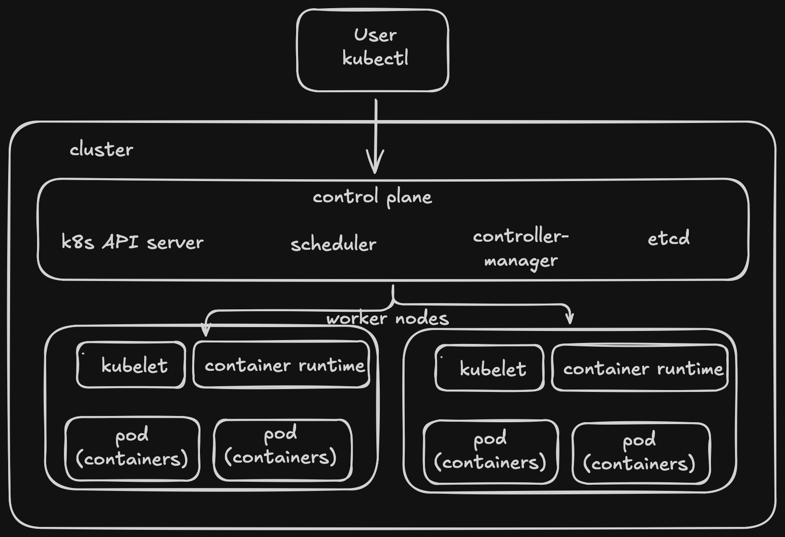
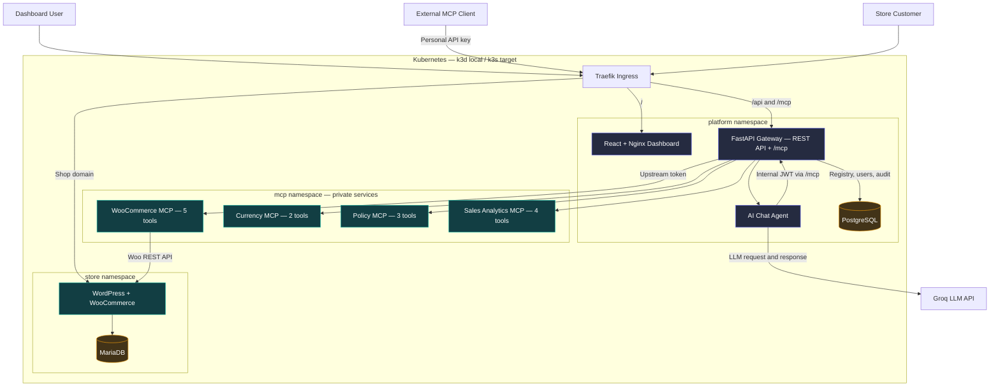

# k8s-mcp-gateway

A Kubernetes-native WooCommerce store and team MCP gateway. One authenticated
Streamable HTTP endpoint aggregates a custom five-tool WooCommerce server and
independent currency, policy, and sales analytics servers. The React dashboard provides team,
key, server, audit, and AI-chat workflows; both chat and external MCP clients
use the same gateway policy and audit path.

## 1. Kubernetes learning model

This diagram is the general Kubernetes mental model used while building the
project. `kubectl` talks to the control plane; the scheduler and controllers
place and maintain Pods on worker nodes; the kubelet and container runtime run
those Pods. In local development, k3d packages this Kubernetes environment into
Docker containers. On a VPS, k3s provides the same Kubernetes APIs in a
lightweight single-node installation.



This is a learning diagram, not the request flow of the application. The next
diagram shows the components actually implemented by this repository.

## 2. Project architecture

The installation uses `store`, `mcp`, and `platform` namespaces. WordPress,
MariaDB, PostgreSQL, the dashboard, gateway, and all four MCP servers run in
Kubernetes. Only the shop and dashboard/gateway have Ingress routes; upstream
MCP services remain private ClusterIP services protected by NetworkPolicy.



The chat agent is a logical module inside the Gateway Deployment, not a separate
Kubernetes workload. Client API keys terminate at the gateway and are never
forwarded upstream; each MCP server receives its own stored credential.

## 3. What the platform provides

- A real WordPress and WooCommerce storefront with Cash on Delivery checkout,
  durable MariaDB storage, and persistent WordPress content.
- One authenticated Streamable HTTP MCP endpoint for dashboard chat and external
  clients.
- Four independent private MCP servers with fourteen tools in total.
- Admin server management, team invitations, personal API keys, immediate key
  revocation, upstream status, and attributed audit logs.
- Dynamic tool discovery and collision-safe names such as
  `woo__list_products` and `policy__list_products`.
- Failure isolation: one unavailable upstream does not prevent the remaining
  servers from listing or executing their tools.
- One Helm umbrella chart rendered with local k3d or VPS k3s values.

### MCP tool catalog

| Server | Gateway tools | Data source |
| --- | --- | --- |
| WooCommerce | `woo__list_products`, `woo__create_product`, `woo__list_orders`, `woo__get_order`, `woo__update_order_status` | Real WooCommerce REST API |
| Currency | `currency__convert_currency`, `currency__get_demo_rates` | Fixed, versioned demonstration rates—not live FX |
| Policy | `policy__list_store_policies`, `policy__get_store_policy`, `policy__list_products` | Versioned demonstration policies and collision fixture |
| Sales Analytics | `analytics__summarize_sales`, `analytics__get_top_products`, `analytics__get_order_status_breakdown`, `analytics__calculate_sales_trend` | Stateless calculations over non-sensitive order fields supplied through the gateway |

WooCommerce write operations are never silently retried after a timeout because
creating a duplicate product is worse than returning an explicit uncertain
result.

## 4. Run locally

### Prerequisites

- Docker, k3d, kubectl, and Helm 3 for local development.
- A Linux VPS with a public IPv4 address, at least 2 vCPU, 4 GiB RAM, and 30 GiB
  free disk for the documented single-node k3s deployment.
- Four application images built from this repository: `gateway`, `woo-mcp`,
  `aux-mcp`, and `dashboard`.
- A Groq API key for dashboard chat. A custom domain is optional; the verified
  demo deployment uses free `nip.io` hostnames with Let's Encrypt TLS.

All image tags in the VPS values are immutable release labels rather than
`latest`. Before a VPS install, publish the four `0.1.0` images to the configured
GHCR paths or replace only their repositories and tags in
`charts/platform/values-vps.yaml`.

### Deploy the platform

Create the pinned k3d cluster and namespaces:

```bash
k3d cluster create k8s-mcp-gateway \
  --image rancher/k3s:v1.35.5-k3s1 \
  --api-port 127.0.0.1:6550 \
  --port 127.0.0.1:8080:80@loadbalancer \
  --wait
kubectl config use-context k3d-k8s-mcp-gateway
kubectl apply -f infra/namespaces.yaml
```

Build the application images with the tags in `values.yaml` and import them:

```bash
docker build -f services/gateway/Dockerfile \
  -t k8s-mcp-gateway/gateway:0.1.0-local .
docker build -t k8s-mcp-gateway/woo-mcp:0.1.0-local services/woo-mcp
docker build -t k8s-mcp-gateway/aux-mcp:0.1.0-local services/aux-mcp
docker build -f web/dashboard/Dockerfile \
  -t k8s-mcp-gateway/dashboard:0.1.0-local .
k3d image import --cluster k8s-mcp-gateway \
  k8s-mcp-gateway/gateway:0.1.0-local \
  k8s-mcp-gateway/woo-mcp:0.1.0-local \
  k8s-mcp-gateway/aux-mcp:0.1.0-local \
  k8s-mcp-gateway/dashboard:0.1.0-local
```

Create the existing Secrets described below, including your local
`GROQ_API_KEY`, then install:

```bash
helm dependency update charts/platform
helm upgrade --install urumi charts/platform \
  --namespace platform \
  --values charts/platform/values-local.yaml \
  --wait --timeout 15m
```

Open `http://shop.127.0.0.1.nip.io:8080` and
`http://app.127.0.0.1.nip.io:8080`.

| Surface | Local address |
| --- | --- |
| Storefront | <http://shop.127.0.0.1.nip.io:8080> |
| WordPress admin | <http://shop.127.0.0.1.nip.io:8080/wp-admin> |
| Team dashboard | <http://app.127.0.0.1.nip.io:8080> |
| Unified MCP endpoint | `http://app.127.0.0.1.nip.io:8080/mcp` |

### Live HTTPS demo

The same umbrella chart is running on a single-node GCP k3s VM. The public IP
is reserved, HTTP redirects permanently to HTTPS, and cert-manager renews the
Let's Encrypt certificates.

| Surface | Live address |
| --- | --- |
| Storefront | <https://shop.35.254.101.77.nip.io> |
| WordPress admin | <https://shop.35.254.101.77.nip.io/wp-admin> |
| Team dashboard | <https://app.35.254.101.77.nip.io> |
| Unified MCP endpoint | `https://app.35.254.101.77.nip.io/mcp` |

The pages are publicly reachable, while dashboard, WordPress, and MCP actions
still require their respective account or bearer credentials. PostgreSQL,
MariaDB, and the four upstream MCP services have no public Ingress.

## 5. Use the application

### Store customer

Open the storefront, add a product, proceed to checkout, and choose **Cash on
Delivery**. The order is persisted by WooCommerce and appears in WordPress admin
under **WooCommerce → Orders**. The same order can be retrieved through the Woo
MCP tools.

### Dashboard administrator

An administrator can:

- register, edit, enable, disable, and inspect MCP servers;
- invite members and change their active status or role;
- issue or revoke member API keys;
- view all attributed tool-call audit events; and
- use AI Chat to create products, inspect orders, and combine multiple upstreams.

Chat calls the gateway's own `/mcp` endpoint with a short-lived token for the
logged-in user. It cannot bypass the gateway router, authorization, or audit
path.

After deployment, register Analytics through **MCP Servers → Add server** with:

```text
Name: Sales Analytics
Slug: analytics
URL: http://analytics-mcp.mcp.svc.cluster.local:8000/mcp
Authentication: Bearer
Credential: the ANALYTICS_MCP_BEARER_TOKEN value from the mcp/aux-mcp Secret
```

Use the same dynamic registration flow for local k3d and VPS k3s. Do not expose
the service through Ingress or give this upstream credential to team members.

### Team member and external MCP client

An invited member accepts the single-use invitation, chooses a password, and
creates a personal API key under **API Keys**. Configure an MCP client with only:

```text
Transport: Streamable HTTP
URL: http://app.127.0.0.1.nip.io:8080/mcp
Header: Authorization: Bearer <personal-gateway-key>
```

For the live deployment, use
`https://app.35.254.101.77.nip.io/mcp` with the same Authorization header.

For MCP Inspector, start the client and enter the values above:

```bash
npx -y @modelcontextprotocol/inspector
```

The personal key is displayed once. Revoking it rejects the next MCP request.
Users never configure or receive the WooCommerce, Currency, Policy, or Analytics upstream
credentials.

### Example AI chat prompts

```text
Create a published virtual product named Urumi Mug priced at 499 INR.
What orders came in today?
List today's order totals and convert the sum from INR to EUR using demo rates.
Fetch all order pages, summarize booked sales, and show the top products by revenue.
```

The analytics workflow is cross-server composition: chat first calls
`woo__list_orders`, passes only order ID, status, currency, total, creation date,
and line items to `analytics__summarize_sales` or
`analytics__get_top_products`, and may then call Currency for an explicitly
labelled demo-rate conversion. Analytics has no store or database connection.
Because Woo order listing is paginated, results cover only the supplied pages;
the tools state this in every response and must not present a partial page as a
complete business total.

## 6. Secrets and security boundaries

The Helm chart renders references to pre-created Secrets and never renders
secret values. Create these resources before installation:

| Namespace | Secret | Required keys |
| --- | --- | --- |
| `store` | `store-mariadb` | `database`, `username`, `password`, `root-password` |
| `store` | `store-wordpress` | `database`, `username`, `password` |
| `store` | `store-wordpress-admin` | `username`, `password`, `email` |
| `mcp` | `woo-mcp` | `MCP_BEARER_TOKEN`, `WOOCOMMERCE_BASE_URL`, `WOOCOMMERCE_OAUTH_BASE_URL`, `WOOCOMMERCE_CONSUMER_KEY`, `WOOCOMMERCE_CONSUMER_SECRET` |
| `mcp` | `aux-mcp` | `CURRENCY_MCP_BEARER_TOKEN`, `POLICY_MCP_BEARER_TOKEN`, `ANALYTICS_MCP_BEARER_TOKEN` |
| `platform` | `platform-postgres` | `database`, `username`, `password`, `database-url` |
| `platform` | `gateway` | `api-key-pepper`, `upstream-credential-key`, `internal-jwt-secret`, `groq-api-key` |
| `platform` | `gateway-bootstrap-admin` | `email`, `password` |
| `platform` | `gateway-upstreams` | `woo-credential` |

Use local files excluded by `.gitignore`, restrict them with `chmod 600`, and
apply them without putting values in shell history. For example:

```bash
kubectl -n platform create secret generic gateway \
  --from-env-file=.env.gateway-vps
```

Apply each Secret from a separate local file so key ownership remains clear:

```bash
kubectl -n store create secret generic store-mariadb --from-env-file=.env.store-mariadb
kubectl -n store create secret generic store-wordpress --from-env-file=.env.store-wordpress
kubectl -n store create secret generic store-wordpress-admin --from-env-file=.env.store-admin
kubectl -n mcp create secret generic woo-mcp --from-env-file=.env.woo-mcp
kubectl -n mcp create secret generic aux-mcp --from-env-file=.env.aux-mcp
kubectl -n platform create secret generic platform-postgres --from-env-file=.env.platform-postgres
kubectl -n platform create secret generic gateway --from-env-file=.env.gateway-vps
kubectl -n platform create secret generic gateway-bootstrap-admin --from-env-file=.env.gateway-admin
kubectl -n platform create secret generic gateway-upstreams --from-env-file=.env.gateway-upstreams
```

The MariaDB username/password/database must match the WordPress Secret. The
PostgreSQL `database-url` must be built from its other three values. The
`gateway-upstreams` `woo-credential` must equal the Woo MCP
`MCP_BEARER_TOKEN`. Generate the API pepper and JWT secret with a cryptographic
random generator and generate `upstream-credential-key` as a Fernet key.

Create the Woo Secret initially with placeholder REST key fields, complete the
store bootstrap, then issue a read/write REST key through **WooCommerce admin →
Settings → Advanced → REST API**. Replace the two REST key fields and restart
`deployment/woo-mcp`. Never write directly to WooCommerce authentication tables.

### Security controls

- Personal gateway keys are random, shown once, stored as hashes, and checked on
  every MCP request.
- Browser passwords are Argon2-hashed; mutating browser requests enforce the
  configured origin.
- Upstream credentials are encrypted in PostgreSQL, remain write-only through
  the API, and replace—not forward—the client's Authorization header.
- Public and internal server URLs are validated to limit SSRF to metadata,
  loopback, and unintended cluster destinations.
- MCP servers have no Ingress. NetworkPolicy allows the gateway to call them and
  blocks unauthorized Pods.
- Order tools omit billing and shipping PII from model-facing responses.
- Every tool attempt records the actor, server, tool, channel, time, duration,
  outcome, and bounded error summary.

See [`docs/THREAT_MODEL.md`](docs/THREAT_MODEL.md) for the detailed threats,
controls, negative tests, and residual risks.

## 7. Verification status

The mandatory local flow has been exercised with two users:

1. User A created a real WooCommerce product through dashboard chat.
2. A customer placed a Cash on Delivery order, and chat retrieved the same order.
3. User B connected through one gateway URL and personal key, discovered all
   the original three upstreams, and called both WooCommerce and Currency tools.
4. Member access to admin operations was denied.
5. Disabling a server removed its tools and denied a cached alias.
6. Scaling Currency to zero made it unreachable while WooCommerce continued
   working.
7. Revoking User B's key returned `401` on the next request.
8. Audit rows contained the correct user, server, tool, duration, and outcome.

The Sales Analytics extension has automated unit, authenticated Streamable HTTP,
gateway registration/audit, and Helm render coverage. It was deployed to local
k3d and the live k3s VPS, where all four servers expose fourteen tools through
the unified gateway. The live HTTPS checks covered secure dashboard login, real
Woo product access through MCP, Groq chat with a visible MCP tool trace,
storefront/cart/checkout rendering, an unauthorized-Pod NetworkPolicy denial,
and upstream scale-to-zero isolation with recovery.

Useful operator checks:

```bash
kubectl get pods,svc,ingress,pvc,networkpolicy -A
helm lint charts/platform -f charts/platform/values-local.yaml
helm template urumi charts/platform -n platform \
  -f charts/platform/values-local.yaml >/tmp/urumi-local.yaml
helm template urumi charts/platform -n platform \
  -f charts/platform/values-vps.yaml >/tmp/urumi-vps.yaml
```

## 8. Single-node k3s VPS deployment

The verified demo runs on k3s `v1.35.5+k3s1` at the live addresses above. It
uses the same chart templates as local k3d, environment-specific ignored values
and pre-created Secrets, a reserved GCP address, bundled Traefik, cert-manager
`v1.21.3`, and two namespace-scoped Let's Encrypt TLS Secrets. The following
steps document how to reproduce that deployment with different hosts.

1. Point `shop.example.com` and `app.example.com` A/AAAA records at the VPS,
   replace those placeholders in `charts/platform/values-vps.yaml`, and wait
   for public DNS resolution.
2. Install the pinned k3s release with its bundled Traefik enabled and confirm
   the node is ready. Review the downloaded installer before running it:

   ```bash
   curl -sfL https://get.k3s.io -o /tmp/install-k3s.sh
   less /tmp/install-k3s.sh
   sudo env INSTALL_K3S_VERSION=v1.35.5+k3s1 sh /tmp/install-k3s.sh
   sudo k3s kubectl get nodes
   ```

   Keep `/etc/rancher/k3s/k3s.yaml` readable only by the deployment operator.
3. Apply `infra/namespaces.yaml` and create every Secret from the table above.
4. Provide TLS Secret `platform-ingress-tls` in **both** `store` and `platform`
   namespaces. Kubernetes Secrets are namespace-scoped. A cert-manager setup may
   issue these certificates, or they may be created from an existing certificate:

   ```bash
   kubectl -n store create secret tls platform-ingress-tls \
     --cert=shop-fullchain.pem --key=shop-private-key.pem
   kubectl -n platform create secret tls platform-ingress-tls \
     --cert=app-fullchain.pem --key=app-private-key.pem
   ```

5. If GHCR packages are private, create a registry pull Secret in all three
   namespaces and attach it to each namespace's default ServiceAccount. Public
   GHCR packages need no registry credential.
6. Review the storage class and PVC sizes in `values-vps.yaml`. The default
   `local-path` class works on standard k3s but keeps data on that single host.
7. Render and inspect before installing:

   ```bash
   helm dependency update charts/platform
   helm lint charts/platform -f charts/platform/values-vps.yaml
   helm template urumi charts/platform --namespace platform \
     -f charts/platform/values-vps.yaml > /tmp/urumi-vps.yaml
   ```

8. Install the same umbrella chart used locally:

   ```bash
   helm upgrade --install urumi charts/platform \
     --namespace platform \
     --values charts/platform/values-vps.yaml \
     --wait --timeout 15m
   kubectl get pods -A
   kubectl get ingress -A
   ```

9. Verify HTTPS, complete the supported WooCommerce REST-key rotation, register
   the currency, policy, and analytics servers through the dashboard, and run the required
   two-user acceptance flow.

Cloud resources, DNS, certificates, and credentials are intentionally not
created by the application chart. The current live deployment was provisioned
out of band and then verified through the public HTTPS routes.

## 9. Upgrades, rollback, and backups

Before every upgrade, back up MariaDB, PostgreSQL, and the WordPress uploads
stored on the `wordpress-content` PVC. Copy backups off the VPS and test a
restore. A PVC protects data from ordinary Pod replacement but not disk or VPS
loss.

```bash
helm history urumi -n platform
helm upgrade urumi charts/platform -n platform \
  -f charts/platform/values-vps.yaml --wait --timeout 15m
helm rollback urumi REVISION -n platform --wait --timeout 15m
```

Helm rollback restores Kubernetes manifests; it does not reverse database
migrations or restore database contents. `helm uninstall` also leaves retained
PVCs that must be reviewed and deleted manually only when data loss is intended.

This topology is intentionally single-node and is **not highly available**. A
node, disk, or provider failure can take down every workload. Off-server backups,
monitoring, OS security updates, firewall rules for 22/80/443, and tested restore
procedures are operational requirements for a real deployment.

## 10. Attempted bonus and stand-out items

| Assignment item | Status | Where to find it |
| --- | --- | --- |
| Multi-store provisioning bonus | Not attempted | The project intentionally keeps one WooCommerce store and prioritizes the mandatory two-user flow. |
| Production-like VPS deployment | Implemented and live-verified | Section 8, `charts/platform/values-vps.yaml`, and the live HTTPS addresses in Section 4. |
| Tool permissions | Implemented | `services/gateway/app/mcp_gateway/permissions.py` and the role-aware checks applied during both `tools/list` and `tools/call`. Members receive the read-only Woo tool set; administrators can use the approved write tools. |
| OAuth on the gateway | Not attempted | External clients authenticate with revocable personal bearer keys. |
| Handling many tools | Not attempted as a separate search/execute layer | The current catalog contains fourteen collision-safe aliases across four servers. |
| Hosted MCP servers by container image | Not attempted | Administrators register existing Streamable HTTP endpoints; the platform does not deploy arbitrary images from the dashboard. |
| Security hardening | Implemented | Section 6, `docs/THREAT_MODEL.md`, URL/redirect validation, encrypted upstream credentials, non-root containers, NetworkPolicies, Secret references, and negative authorization tests. |
| Scaling | Not attempted beyond the single gateway replica | The gateway is stateless and database-backed, but multi-replica coordination is not claimed as verified. |
| Observability | Partially implemented | The dashboard reports upstream state and bounded errors, while audit records capture actor, server, tool, channel, outcome, and duration. Prometheus-compatible metrics are not implemented. |
| Upgrades and rollback | Documented and Helm-render verified | Section 9 describes Helm history, upgrade, rollback, database-migration limits, and backup expectations. A complete off-node backup restore has not been rehearsed. |

Sales Analytics is an additional fourth independent MCP server beyond the
mandatory three-server baseline. It is a stateless in-cluster server registered
through the same dynamic gateway flow; it is not the assignment's hosted-server
provisioning feature or multi-store bonus.

## 11. Repository map

```text
charts/                 Umbrella and component Helm charts
infra/                  Namespace manifests and public infrastructure notes
services/gateway/       FastAPI REST API, MCP gateway, auth, chat, audit, migrations
services/woo-mcp/       Custom five-tool WooCommerce MCP server
services/aux-mcp/       Independent Currency, Policy, and Analytics MCP servers
web/dashboard/          React dashboard and AI chat interface
docs/THREAT_MODEL.md    Public security analysis and residual risks
docs/images/            Kubernetes learning diagram
```

### Current boundary

The complete mandatory application works locally on k3d and has also been
deployed with the same Helm templates to the single-node k3s VPS described in
Section 8. The live `nip.io` routes and Let's Encrypt certificates were verified.
This remains a demonstration deployment rather than a highly available
production service. A complete off-node backup-and-restore rehearsal has not
been performed, and multi-store provisioning was not attempted.
