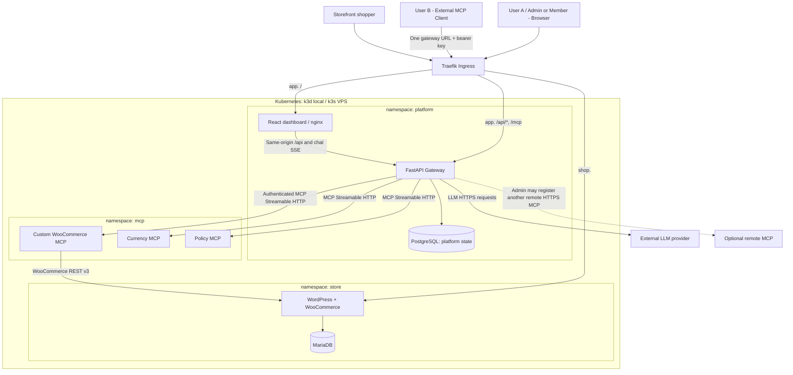

# High-Level Design: Kubernetes-Native Team MCP Gateway

**Project:** `k8s-mcp-gateway`  
**Purpose:** Urumi AI FDE, Round 1  
**Status:** Final architecture baseline for implementation, v1.0 — not a claim that the system is built  
**Date:** 2026-10-12  
**Source of requirements:** `Urumi AI FDE Internship - Round 1: MCP Gateway on Kubernetes` (8-page brief). The uploaded `ROADMAP.md` informed this design, but is superseded by this package wherever they differ.

## 1. Objective and success criteria

Deliver a real, **single-store WooCommerce hosting system** on Kubernetes, plus a **team MCP gateway** that exposes tools from **at least three independently deployed Streamable HTTP MCP servers** through one authenticated endpoint. An admin connects upstreams in a React dashboard. Team members access the same aggregated tools through the dashboard's LLM chat and an external MCP client. **Only the gateway may call upstream MCP servers**. Use identical Helm chart templates on k3d (local) and k3s (VPS), changing only values, secrets, domains and environment bootstrap configuration.

The system is done only when the original assignment's two-user definition-of-done is demonstrated: test checkout, chat-created product, real order queried through chat, external client with one gateway URL/key, a two-upstream prompt, revocation, server disable, upstream outage without cascading failure, and correctly attributed audit logs. The store, databases, MCP servers, gateway and frontend must run inside Kubernetes.

## 2. System context and high-level topology

**Diagram note:** The gateway's chat module is an MCP *client* to its **own gateway `/mcp` endpoint**, using a short-lived, user-scoped internal credential. Thus browser chat and external clients execute through **identical policy, routing and audit paths**. The gateway's LLM calls are separate HTTPS requests; the LLM is not permitted to contact MCP upstreams directly.

### Public vs private networking

| Entry point | Exposure | Destination | Authentication |
|---|---|---|---|
| `shop.<domain>` | Public Ingress | WordPress Service, `store` | WooCommerce's own shopper/admin flows |
| `app.<domain>/` | Public Ingress | React/nginx, `platform` | Dashboard auth where applicable |
| `app.<domain>/api/*` | Public Ingress | Gateway REST, `platform` | Cookie session / role checks |
| `app.<domain>/mcp` | Public Ingress | Gateway Streamable HTTP, `platform` | Personal bearer API key |
| `woocommerce-mcp.mcp.svc.cluster.local` | ClusterIP only | Custom MCP, `mcp` | Gateway-only NetworkPolicy + upstream static bearer |
| `currency-mcp`, `policy-mcp` | ClusterIP only | Auxiliary MCP Pods, `mcp` | Gateway-only NetworkPolicy; optional static bearer |
| PostgreSQL / MariaDB Services | ClusterIP only | Databases | Client-specific credentials + NetworkPolicies |

Public routes use a **single `app` host** for dashboard, `/api`, and `/mcp`; an independent `shop` host exposes the store. Traefik must be configured to route specific API/MCP prefixes before the dashboard fallback. Other Pods must not contact upstream MCP servers directly; policies must be tested rather than assumed effective.

## 3. Independent deployable workloads

| Component | What it owns | Kubernetes workload | Namespace |
|---|---|---|---|
| WordPress + WooCommerce | Storefront, admin UI, checkout, products and orders | One-replica Deployment + WordPress-content PVC | `store` |
| MariaDB | WordPress transactional data | StatefulSet + its own PVC | `store` |
| WooCommerce MCP | **Custom** five-tool adapter over WooCommerce REST v3 | Deployment + ClusterIP | `mcp` |
| Currency MCP | Independent Streamable HTTP server with labeled, fixed demo FX rates | Deployment + ClusterIP | `mcp` |
| Policy MCP | Independent Streamable HTTP server exposing example store-policy/runbook tools | Deployment + ClusterIP | `mcp` |
| Gateway / chat backend | Registry, identity, MCP proxy, dynamic discovery, tool execution, audit, LLM loop | FastAPI Deployment + ClusterIP | `platform` |
| PostgreSQL | All platform state; no WooCommerce business data | StatefulSet + PVC | `platform` |
| Dashboard | Admin/member UI, server status, API keys, audit, chat | React static bundle in nginx Deployment + ClusterIP | `platform` |

The two auxiliary MCP servers are intentionally **real separate processes** using the protocol, not hardcoded gateway tools. They make offline demonstration deterministic. The registry also supports an optional **fourth** external HTTPS server with a dedicated upstream credential, to demonstrate generality.

## 4. Architecture decisions (locked unless a spike disproves compatibility)

| ID | Decision | Justification / trade-off |
|---|---|---|
| ADR-01 | Python 3.11+/FastAPI as a **modular monolith** for REST gateway and chat | Shared auth/DB/audit model; no need for auth/chat microservices |
| ADR-02 | Official `mcp` Python SDK **v2**, pin tested patch version after compatibility spike | SDK v2 supports modern MCP and fallback for older clients; v1 examples must not be mixed |
| ADR-03 | Custom MCP servers use SDK v2 **`MCPServer`**; the dynamic gateway uses SDK v2 **low-level `Server` with `on_list_tools` and `on_call_tool`** | Exact dynamic tool catalog and routing require low-level handlers and explicit JSON Schema validation |
| ADR-04 | React + TypeScript + Vite; same-origin REST/chat URLs | Predictable UX, avoids cross-origin complexity |
| ADR-05 | PostgreSQL for gateway state; MariaDB for WooCommerce | Clear data ownership, relational integrity and durable audit trail |
| ADR-06 | Three namespaces: `platform`, `mcp`, `store` | Clear isolation boundaries, demonstrable namespace-specific policies |
| ADR-07 | Modular Helm component charts assembled by a `platform` umbrella release | Independent templates, single install/upgrade, same charts on both environments |
| ADR-08 | Local k3d; single-node production-like VPS k3s | Similar Kubernetes distribution, Traefik, storage approach and NetworkPolicy enforcement |
| ADR-09 | Exactly three cluster-local upstreams are required baseline; remote integration is an optional fourth | Guaranteed independent demo, without dependence on external API availability |
| ADR-10 | Immutable unique upstream slug and alias `slug__originalToolName` | Prevent collisions; exact alias-to-origin mapping persisted in PostgreSQL |
| ADR-11 | **Cached tool catalog** with bounded health refresh and synchronous refresh after registration/edit | `tools/list` is fast and does not wait on an offline upstream |
| ADR-12 | For an **unreachable but enabled** upstream, retain its last known tools in listings, visibly flag unhealthy status, and return a bounded clear error when called; **disabled** tools disappear immediately | Stable catalog during temporary outages; explicit disable semantics; failure isolation |
| ADR-13 | Opaque, individually revocable gateway API keys; web sessions via HttpOnly cookies | Meets two-user and team-management requirements without mandatory OAuth |
| ADR-14 | Chat authenticates as the logged-in user and calls gateway's actual `/mcp` endpoint using a short-lived internal user token | One authorization, routing and audit pipeline |
| ADR-15 | Encrypt upstream secrets in Postgres; separate secrets for gateway key, each MCP upstream and WooCommerce API; **never forward client tokens** | Separation of identity and delegated service credentials |
| ADR-16 | WooCommerce REST v3 using **supported API-key issuance**; OAuth 1.0a for internal plain HTTP or verified HTTPS Basic Auth | Avoid undocumented SQL manipulation of WooCommerce auth tables |
| ADR-17 | Gateway starts at one replica; stateless API architecture and DB-backed state from day one | Meet mandatory reliability first; demonstrate two replicas only after validating shared background work |
| ADR-18 | NetworkPolicies for ingress to private MCP servers and DBs, minimal ServiceAccounts, Kubernetes Secrets, persistent volume claims, all probes and resource requests/limits | Match explicit infrastructure/security requirements |
| ADR-19 | Use configurable external LLM with proven tool/function calling; don't self-host a model in Kubernetes | Keep CPU/RAM focused on platform; choose provider via validated spike |
| ADR-20 | Write changes and upgrades as idempotent, with no automatic retry of non-idempotent write tools | Avoid creating duplicate products/orders on timeout or network retries |

### SDK detail important to implementers

The SDK v2 `MCPServer` is the high-level abstraction for fixed tools; its **low-level server** now accepts `on_*` callbacks in the constructor and returns full typed protocol result objects. Low-level tool calls **do not automatically validate incoming arguments**; our gateway explicitly validates them against cached JSON Schema before forwarding and catches expected upstream errors to return a proper `CallToolResult`. Confirm the exact patch version/API in Day 1 testing.

## 5. Core end-to-end flows

### 5.1 Admin registers an MCP server

1. Signed-in admin sends URL, immutable slug, display name, enabled state and optional bearer/custom-header credential to `POST /api/servers`.
2. Gateway authorizes admin, validates endpoint scheme/host/IP policy, encrypts secret at rest and creates an upstream row in Postgres.
3. A bounded MCP client connection fetches tool definitions (and all pages when supported); gateway validates schemas, generates safe unique aliases and stores tool snapshots.
4. Dashboard shows Connected or Unreachable with last error. A newly enabled server becomes visible to `tools/list` without application redeployment.
5. Existing clients may cache discovery; clients can refresh/reconnect. Disabling a server is **always enforced during call routing**, even if a caller has stale tool definitions.

### 5.2 External client invocation

1. User B configures **only** `https://app.<domain>/mcp` and B's personal bearer key in a real MCP client.
2. Gateway authenticates key against **stored digest, expiry/revocation and user status on each request**. It does not authenticate merely at connection establishment.
3. `tools/list` returns aliases from the stored catalog for currently enabled, authorized upstreams; no synchronous upstream call.
4. `tools/call` resolves exact alias from DB, checks current enabled state and permissions, validates JSON Schema, records start time, then invokes the owning upstream using **gateway-held** credentials.
5. Result or bounded error is relayed; one user-attributed audit event records server, tool, timestamp, latency and outcome.

### 5.3 Dashboard chat invocation

1. User A signs into React, asks a question; browser calls `/api/chat` with web session credentials.
2. Backend obtains a short-lived internal JWT with User A's identity and dedicated audience; it opens a real MCP client to the gateway's **internal HTTP `/mcp` Service** (not directly to upstreams).
3. Backend lists only user-visible tools, passes definitions to the LLM and executes the resulting tool calls **through the same gateway `/mcp` endpoint**.
4. MCP path records audits as User A with `channel=chat`; UI shows tool cards and results before the final answer.

### 5.4 Dead/slow upstream

- Tool listing comes from PostgreSQL and does not hang if a remote server is dead.
- A periodic health worker marks `Connected`, `Unreachable` or `Disabled`; **gateway readiness must not depend on every upstream's health**.
- Cached last-known tools for an *enabled but unreachable* server remain discoverable, but calls fail with a clear bounded error. Disabling removes tools on the next listing and causes direct calls to be rejected immediately.
- Currency and policy tools still work if WooCommerce MCP is down, and vice versa.
- No automatic retry for `create_product` or `update_order_status` after uncertain timeouts.

## 6. Security and trust boundaries

**Security plane 1 — Kubernetes.** `store`, `mcp`, `platform` namespaces; allow only gateway-labelled Pods in `platform` to reach upstream MCP ports; allow only Woo MCP to reach the store REST Service as needed; DBs accept only their owning applications; Traefik reaches public Services. Scope egress deliberately, including DNS and LLM/external HTTPS. Verify policy enforcement on both k3d and k3s. App Pods don't need to query the Kubernetes API and should not mount ServiceAccount tokens automatically.

**Security plane 2 — gateway application.** Admin vs member authorization for management, own keys, audit visibility, and (stand-out) tool-level permissions. User credentials never sent to upstreams; each upstream receives only its scoped secret. Admin server URLs are treated as SSRF-sensitive; reject unsupported schemes, metadata endpoints, unsafe redirects, loopback/private targets except explicitly approved cluster services; revalidate resolved addresses on connect. Client-visible responses do not reveal secrets or raw upstream exception stacks.

**Security plane 3 — LLM context.** Tool schemas/descriptions and returned data are **untrusted**, not executable instructions. Apply output size caps, filter exposed tools by user authorization, avoid supplying unnecessary customer personal information to an LLM, and do not accept a model's claim that a write succeeded unless a real tool result confirms it. Read/write policies restrict high-impact tools where configured.

A detailed threat model and residual risks live in `THREAT_MODEL.md`.

## 7. Helm and environment portability

**Packaging:** component charts for `store`, `woo-mcp`, `aux-mcp`, `gateway`, `platform-db`, and `dashboard`, composed through `charts/platform/Chart.yaml` with `file://` dependencies. One platform release is stored in `platform`; templates explicitly target their component namespaces. **Bootstrap the three namespaces before installing Helm** using a checked-in manifest/script; do not rely on `--create-namespace` to make all three. Ensure chart install/upgrade/uninstall semantics are validated across namespaces.

| Parameter | Local (k3d) | VPS (k3s) |
|---|---|---|
| Hosts | `shop.127.0.0.1.nip.io` and `app.127.0.0.1.nip.io` (verify DNS resolution) | Real shop and app DNS records |
| TLS | Local HTTP initially | TLS via cert-manager / verified ingress certificate |
| Images | Locally built and imported / registry available to k3d | Version-pinned images from GHCR or another registry |
| Storage | k3s local-path StorageClass, small PVCs | k3s local-path or configured VPS StorageClass, larger PVCs + off-server backups |
| Secrets | Created by documented local bootstrap commands | Created securely out of band, **referenced** by name in Helm values |
| Resources | Lower requests/limits within machine budget | Sized to actual VPS capacity |
| Replicas | Gateway 1 initially | Gateway 1 initially; optional 2 only after background-worker coordination passes |

All Deployments/StatefulSets must have probes and CPU/memory requests and limits; WordPress/MariaDB should have startup probes where beneficial. A PVC prevents data loss on ordinary Pod replacement but **does not replace backups**. A single-node VPS is not host-level HA. Helm rollback restores manifests, **not necessarily database content or schema**, so backups and additive migrations are part of the upgrade story.

### Secrets and bootstrap

All real passwords and external API keys are supplied via pre-created Kubernetes Secrets or secret-management tooling, not committed values files or templates. Platform chart references `existingSecret` names; no sensitive values embedded in Helm release metadata. Bootstrap WordPress and WooCommerce with documented, preferably idempotent WP-CLI steps. Issue the Woo REST key via a **supported WooCommerce mechanism** (UI is the safe fallback; the documented app authentication endpoint may be evaluated). Avoid direct writes into `wp_woocommerce_api_keys`. Pre-seed the bootstrap admin and **WooCommerce as the first registered upstream** idempotently. Admin then registers currency and policy through the dashboard (or a documented setup API) without redeploying; never log or return raw credentials.

## 8. Scope tiers

**Mandatory, never cut:** full storefront and COD checkout; all five Woo tools; three upstream MCP servers; complete dynamic admin CRUD; two users with roles, personal keys and revocation; same endpoint for external client/chat; audit trail; upstream disable/unreachable handling; single gateway endpoint, tool collisions, safe credentials; probes/storage/Ingress/Secrets/Helm for local and VPS; repo + demo + design/tradeoffs + threat model.

**Prioritized differentiators after mandatory green:** (a) a real VPS deployment with TLS, (b) per-role tool permissions enforced during both list and call, (c) per-server latency/error metrics plus clearer health diagnostics, (d) a fourth real external MCP server, (e) two gateway replicas with safe coordination and a clean demo.

**Deferred bonus:** multi-store provisioning with per-store namespaces, DB/PVC, automatic MCP registration, idempotent reconciliation and teardown, quotas/limits; hosted image-based MCP servers; OAuth login for external clients; huge-tool-catalog retrieval strategies. Architect to make these possible, not required for the core delivery.

## 9. Key implementation risks and gates

| Risk | Required evidence before relying on it |
|---|---|
| MCP SDK / external client compatibility | Pinned SDK v2, one real downstream external client, an `on_list_tools` + `on_call_tool` gateway spike, both tool-list and call; test modern and legacy client if practical |
| WordPress/Woo setup and REST auth | Actual COD checkout and working Woo REST GET and POST from Woo MCP Pod; verify OAuth1 on internal HTTP or another supported auth route |
| Multi-namespace Helm charts | Fresh install/upgrade/uninstall with explicit namespaces and cross-namespace DNS; no orphaned release resources or accidental PVC deletion |
| Dynamic registry/collision | Add a server at runtime, list aliased tools, call a collision safely, and disable without redeploy |
| Identity/audit | Distinct A/B identities, revoked B rejected **on next call**, chat tools attributed to A |
| Failure isolation | Stop one server, confirm status change by bounded probe time, others unaffected, no `tools/list` hang |
| NetworkPolicy | Negative test from unauthorized namespace/Pod fails, gateway-to-upstream succeeds |
| Portable deployment | Same templates render for k3d/k3s with values/secrets changes only; actual VPS smoke test as standout |

## 10. References

- Urumi assignment, pages 1–8 (authoritative scope and acceptance criteria).
- User-supplied `ROADMAP.md` (original technical options and schedule).
- Official MCP Python SDK v2: https://github.com/modelcontextprotocol/python-sdk ; v2 migration: https://github.com/modelcontextprotocol/python-sdk/blob/main/docs/migration.md
- MCP 2026-07-28 overview: https://blog.modelcontextprotocol.io/posts/2026-07-28/
- Official WooCommerce REST auth: https://developer.woocommerce.com/docs/apis/rest-api/authentication
- k3s networking/NetworkPolicy: https://docs.k3s.io/networking/networking-services
- Helm documentation: https://helm.sh/docs/
